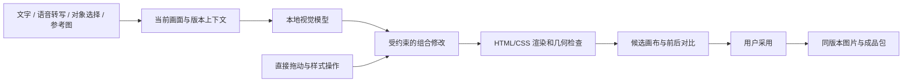

# 图文共创工作台

本次实现基于截图对应的 `codex/day1-review-recovery`（6681ab1），原在 `codex/multimodal-studio` 独立分支扩展，现已整合到 `main`。正式入口仍为 FastAPI；四角色创作、稿件确认和发布授权规则保持原有边界。

## 使用路径

确认一份创作稿后，下方进入“图文共创”。左侧切页或上传产品图、风格参考图；中间选择标题、正文、产品图，或圈出一个区域；右侧用文字描述修改要求，也可主动开启语音，将转写文字检查后发送。

- 对象可拖动，方向键移动；缩放、配色、三种构图也可直接操作。
- 对话使用当前画面、选区、明确附上的参考图、设计参数和最近对话。支持一次修改多个对象，以及“再小一点”等连续要求。
- 产品素材可以替换指定页的图片；参考图片只作为风格依据，不自动替换产品。
- 未采用的修改、素材与对话保存在服务器；刷新后可继续。撤销、重做和撤回未采用修改各有明确入口。
- 前后对比显示已采用版本与当前候选。采用后才可导出，导出绑定服务器上的稿件与排版版本。

首版保留标题和正文原文。若希望改写文案，应回到稿件编辑与审核流程；当前画布仅调整结构和样式。三个构图入口分别为大图主视觉、清单卡片、图文对照，后者只是图文并排，不生成没有来源的产品对比结论。

## 技术路径



`backend/studio.py` 保存会话、历史和素材，以 owner、run、draft_ref、content_hash 隔离；expected_revision 与幂等键保护并发操作。渲染失败不覆盖原作品，模型迟到结果不能覆盖新版本。图片字节集中保存，版本历史引用素材 ID。

`backend/studio_vision.py` 将实际画布、可选区域与素材转为有来源身份的图像输入，经 `Calls.invoke_studio_vision` 调用本机 Ollama `qwen3-vl:4b`。不使用字符串规则伪装视觉结果，不自动调用收费云模型。调用台账保留路由、模型、输入/图像哈希、来源、稿件快照与真实用量；失败和未知用量分别记录。

`backend/html_cards.py` 提供稳定元素 ID 及 1080×1440 坐标。直接编辑与 AI 修改最终使用同一组受校验参数；标题、正文仍是真实文字排版。渲染检查正文完整性、元素越界及相互遮挡；失败会要求调整，不裁掉内容冒充成功。

新增数据库结构通过迁移 11 追加，未修改已发布 SQL。旧媒体接口保留兼容，共创导出使用服务端已采用版本。

## 运行与验证

在本次实现的工作树中执行：

```bash
cd "/Users/lanxinrui/.codex/worktrees/creator-real-workflow/多agent协作社媒博主创建爆款推文"
runtime/venv/bin/python scripts/local_dev.py start
```

启动器同时运行 API 与 Worker。Ollama 中需已有 `qwen3-vl:4b`；模型离线时，直接画布编辑仍可用，对话修改显示明确错误。项目配置不包含在提交中。

工程验证按 AGENTS.md 执行全量 unittest（配置 TEST_DATABASE_URL，包含实际 PostgreSQL）、前端测试、全部前端脚本语法检查、角色卡同步一致性及 git diff --check。

可复现的独立浏览器验收：

```bash
runtime/venv/bin/python scripts/verify_studio_browser.py
runtime/venv/bin/python scripts/verify_studio_browser.py --live-vision
```

脚本创建并清理独立 PostgreSQL schema，使用构造的已确认稿件与仓库中带授权信息的产品图，检查真实浏览器、刷新恢复、撤销重做与导出字节一致性。`--live-vision` 额外调用本机视觉模型，不使用收费提供商。报告和截图写到忽略提交的 `runtime/studio-evidence/`。这不是真实创作者反馈或平台发布证据。

## 能力边界

语音输入使用浏览器 SpeechRecognition，用户主动启停，转写后手动发送；是否可用取决于浏览器、麦克风权限及其语音服务。可选朗读使用浏览器 speechSynthesis。自动化测试验证事件与权限失败处理，不替代真实麦克风和扬声器验收。

当前不含生成式修图、背景生成、真人口播或可编辑视频时间线；原有无声翻页视频导出仍可使用。位移、缩放、图片大小和页数受明确范围限制。限制外的要求会说明原因，候选结果须由用户核对采用。

## 开源参考

参考了 [OpenMAIC 对象引用](https://github.com/THU-MAIC/OpenMAIC/blob/9bbd34e6f12530740f750389f5c2c206ab2e6d0e/lib/chat/pi/element-reference.ts)、[结构化编辑和历史](https://github.com/THU-MAIC/OpenMAIC/blob/9bbd34e6f12530740f750389f5c2c206ab2e6d0e/lib/edit/slide-ops.ts) 的机制。本次以原项目技术栈独立实现，没有嵌入课堂或复制整套运行时。既有图卡主题与产品图片的第三方声明沿用原有随包来源和许可说明。

## 本次实际验收（2026-10-09）

真实本地 `qwen3-vl:4b` 连续两轮操作通过：第一轮保留当前 0.9 倍产品图，并将背景改为 `#e7f0e7`；第二轮“产品图再小一点，保持刚才的背景和其他元素不变”将图片改为 0.8 倍，背景与文字保持。两轮耗时分别为 21.59 秒和 16.38 秒，仅是本机本次记录，不是性能保证。

实际 Chromium 验证了选择对象、连续缩放、上传参考图、刷新恢复、撤销重做、前后对比、采用、浏览器下载完整 ZIP，以及导出 PNG 与已采用预览逐字节一致。桌面与窄屏无横向溢出、无浏览器异常。验收使用构造稿件和隔离数据库，报告位于 `runtime/studio-final-evidence/report.json`，不提交测试用户或运行数据。

本机 API 和 Worker 已通过启动器一起启动，`/health` 返回 PostgreSQL 正常；服务提供的 `media_exports.js` 与本工作树文件 SHA-256 一致。没有进行公网部署、平台发布或收费模型验收。

最终工程检查：全量 unittest 共 1013 项通过、零跳过（含真实 PostgreSQL）；前端 Node 测试 314 项通过、零跳过；12 份前端脚本语法检查、角色卡同步一致性和 `git diff --check` 通过。浏览器布局测试随后使用项目统一浏览器发现方式单独复测，1 项通过。

## 2026-10-09 用户反馈修复

实际调用确认画布使用 Ollama `qwen3-vl:4b`。旧实现对“把产品图作为背景图，文字半透明”只返回图片 scale=1 和浅灰色正文，缺少背景层与 opacity 能力，且直接展示了模型不可靠的完成说明。现在支持 image.placement=background/inline 与 title/body.opacity=0..1；回复由已提交参数差异生成，不再展示未经验证的模型 observation。任意意图的完整满足程度仍不能仅凭参数合法性判定。

撤销/重做位于画布顶部固定工具栏；无历史或正在操作时显示不可用原因。另提供“用作整页背景 / 恢复前景图片”和文字不透明度滑杆。背景图按 cover 裁切铺满；需保留完整产品外形时可恢复前景。文字不透明度影响实际文字 alpha，低不透明度叠在复杂照片上可能降低可读性，可调整颜色或不透明度。

使用用户原句的真实本地模型验收通过：第2页图片 placement=background、标题和正文 opacity=0.5。撤销重做恢复同一设计，导出与预览逐字节一致。报告及实际导出图位于 `runtime/studio-background-evidence/`，使用隔离构造稿件，没有修改用户现有稿件。

### gc-minimal-zine-poster 借鉴范围

参考 [官方 SKILL.md](https://github.com/LiamGvchi/gc-minimal-zine-poster/blob/main/SKILL.md) 及其 [质量检查](https://github.com/LiamGvchi/gc-minimal-zine-poster/blob/main/references/quality-gate.md)：区分原图与风格参考、保留产品身份、使用可核验的布局参数，并实际检查导出结果。这里只借鉴方法，没有复制或完整嵌入该 Skill 的生图工作流，也没有增加生成式修图服务。该 Skill 的小主体/大留白风格不是用户明确要求铺满背景时的限制。

### 联网状态

现有公开搜索接口和创作联网调查是真实网络请求，画布 Agent 尚未调用搜索工具。本次使用项目搜索成功取得该 Skill 的官方 GitHub 链接，但网页正文读取因 DNS 地址触发内网保护被拒绝，不能宣称已读正文。真实搜索成功、正文读取成功、素材可用和画布实际采用是不同验收项。未自动下载网络图片作为产品素材。

本次修复最终验证：1109 项 Python 测试通过、零跳过（含真实 PostgreSQL）；319 项前端测试通过、零跳过；真实模型原句、桌面/手机撤销布局与对象选中、导出一致性、12 份前端脚本语法、角色卡同步及空白检查通过。
