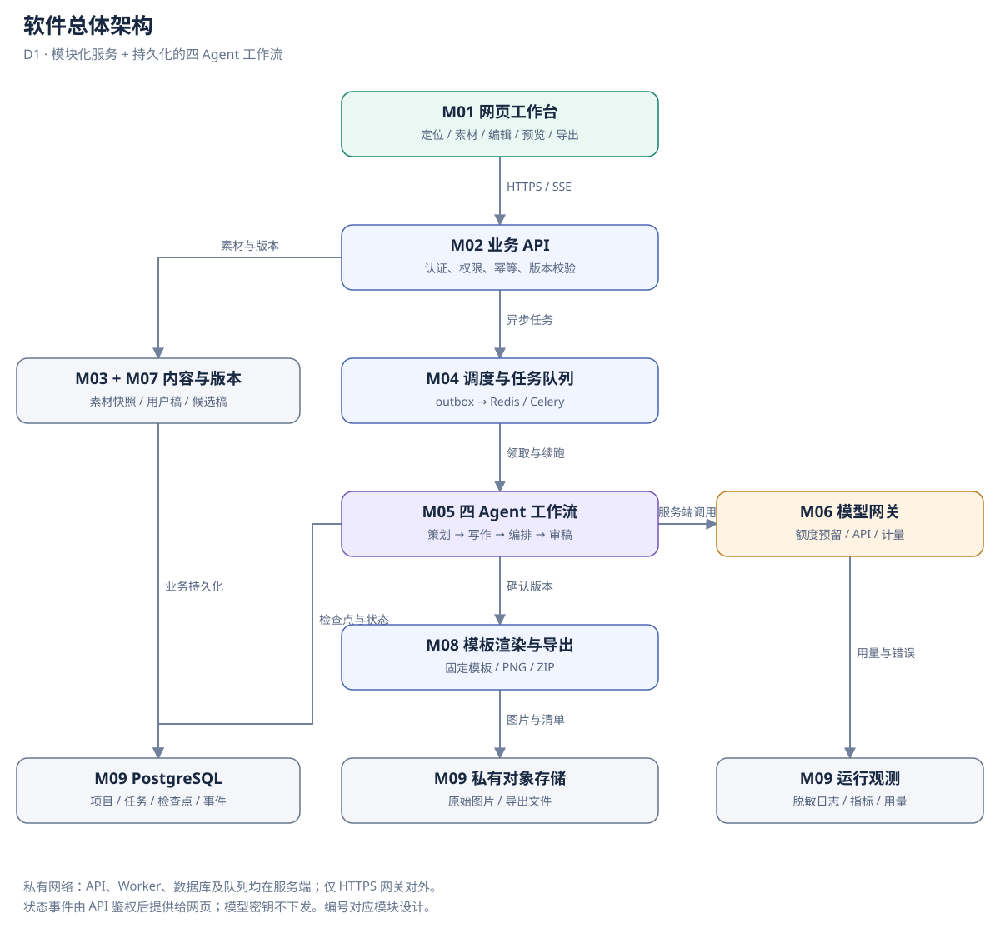
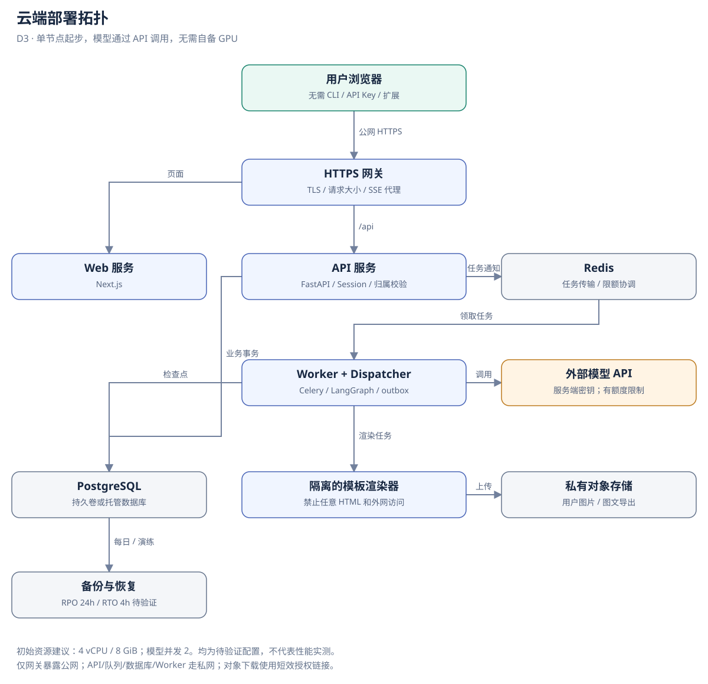

# 软件架构与关键参数

> **当前需求（2026-10-10，已授权实施）**：[小红书连接、研究资料库与多模型](CONNECTED_CREATOR_REQUIREMENTS.md)。新增能力以该基线为准；下文旧阶段限制和完成记录保留其日期与实现边界，不作为拒绝新需求的依据。

> 阅读顺序：当前实现见 [开发进度](../IMPLEMENTATION_STATUS.md)；本轮新方向见文末 v0.4 章节。前文 v0.3 内容保留为创作子流程与历史设计基线。

版本 v0.3 · 2026-09-20 · 设计方案，尚未实现或实测。

## 1. 产品目标与边界

面向有真实素材的个人博主，完成账号定位、选题、文案、图文编排、审稿、用户定稿和导出。目标是提高可用稿比例、降低修改成本，不保证传播效果。

MVP 支持文本资料及 JPG/PNG/WebP 图片；不自动抓取链接，链接仅保存为来源元数据。暂不支持 PDF/OCR、视频、多人实时编辑、自动发布或商业支付。图片仅作为排版素材，未接多模态模型前不声称已经识别图片内容，用户可填说明。

用户角色：创作者管理自己的项目；运营管理员查看脱敏运行指标和额度配置，默认不能读取用户正文。小范围试用采用邀请注册和经过验证的认证库，密码仅保存强哈希。

## 2. 总体架构

### 五层职责与调用边界

| 层 | 内容 | 负责 / 不负责 |
| --- | --- | --- |
| L1 UI / Runtime Console | M01 工作台、M10 运行控制台 | 收集 Brief、编辑、确认、显示事件；不能在浏览器决定审核通过 |
| L2 Orchestrator | M02 API、M04 调度、M05 编排控制 | 冻结快照、并行、汇合、分支、预算、暂停恢复；不是第五个 Agent |
| L3 Agents | audience / research / content / reviewer | 聚焦领域判断、产出结构化成果；不直接写共享数据库或自行切换全局状态 |
| L4 Tools / Skills | M08 确定性工具、M11 Skill Registry | Tool 执行能力，Skill 提供版本化方法；Skill 不能获得额外权限 |
| L5 Memory | M03 资料与画像、M07 版本历史、M09 存储 | Profile / Material / History；证据与推测分开，用户隔离 |

M06 模型网关是受 L2 预算控制、供 L3 使用的基础设施，不额外算作一层。身份、审计、队列、对象存储同样不增加逻辑层数。

L1 通过鉴权 API 读取状态并提交用户动作；L2 调用 L3，L3 只能通过获准的 L4 工具访问 L5。服务端加载已批准 Skill 到角色上下文；Skill 不是随意执行的远程脚本。L2 另有检查点/事件持久化通道，用于恢复和观测，不能当作 Agent 的长期记忆。

用户修改画像/资料或回填指标，由 API 做校验并写 Memory。Agent 仅提交候选记忆，须用户接受才能进入画像；模型生成的假设不得当成真实历史数据。Runtime Console 订阅各层产生的统一事件，权限和内容脱敏由服务端执行。

### 2.1 技术选型与取舍

| 部分 | 建议选择 | 理由与边界 |
| --- | --- | --- |
| 前端 | Next.js、TypeScript | 表单、编辑器、预览；业务状态以服务器为准 |
| API | FastAPI、Pydantic、SQLAlchemy、Alembic | 统一接口契约、数据库迁移与鉴权 |
| 编排 | LangGraph | 条件分支、人工中断、检查点；不同时引入 AutoGen |
| 后台 | Celery、Redis | 长任务独立于请求；业务结果不依赖 Celery result backend |
| 数据 | PostgreSQL | 用户、版本、任务及 LangGraph 持久化检查点 |
| 文件 | S3 兼容对象存储 | 私有图片、渲染结果；经鉴权签发短效下载链接 |
| 图文 | 固定 HTML/CSS 模板、服务端 Chromium 渲染 | 可控文字和版式，无需 AI 图像模型；渲染进程禁止任意网络 |
| 模型 | 服务端 Provider Adapter | 配置模型名、超时、结构化输出策略，后续可替换供应商 |
| 部署 | Docker Compose 起步 | 一个云端应用节点即可试运行，不预先拆分微服务 |

Node/Python 和依赖的具体版本须在初始化时选择仍受支持且兼容的版本，生成锁文件和容器镜像标识。本文没有宣称任何版本组合已经测试通过。

### 2.2 信任和网络边界

公网只暴露 HTTPS 入口；数据库、Redis、Worker、渲染器无公网端口。前端不接触模型密钥。模型调用只发送当前任务必需的素材；不得跨用户共享提示词缓存。上传按文件真实类型和尺寸校验，重新编码图片、去除元数据，不允许上传 SVG/HTML 执行脚本。

渲染器仅接受模板 ID 和转义后的字段，不接受任意 HTML/JavaScript；只加载已授权对象资源，不接受模型给出的任意 URL，避免 SSRF。外部素材中的命令只作为资料，不拥有系统或工具权限。

## 3. 部署拓扑与资源

建议试用起点：应用节点 4 vCPU / 8 GiB，模型通过外部 API 调用，因此不要求 GPU。数据库可先同机持久卷，较稳妥的试用环境优先托管 PostgreSQL；对象存储单独服务。资源数字仅是启动配置，不能推出并发或稳定性保证。

Compose 服务建议：gateway、web、api、worker、dispatcher、renderer、postgres、redis；同一镜像可运行 API/worker/dispatcher 的不同入口。dispatcher 负责 outbox 和超时回收，只有一个逻辑领导者；采用数据库锁防止多实例重复领取。

部署步骤：配置密钥与私有存储 → 数据库迁移 → 启动 API/Worker → 健康检查 → HTTPS → 邀请试用 → 从外网执行验收。滚动升级先停止领取新任务，排空/持久化现有任务；迁移遵循先兼容后移除。回滚记录镜像摘要和数据库迁移版本，不承诺任意迁移都可无损回滚。

## 4. 状态、队列和持久化

PostgreSQL 的 run 状态为业务事实源；Redis 用于任务传输及短期通知，不存唯一副本。outbox 与 run 同一事务写入；投递成功后标记，重复投递通过唯一键和租约去重。运行事件先入库，再通知 SSE 客户端。

同一个 run 只允许一名 Worker 持有效租约。租约有递增 fencing_token；所有进度和结果写入都校验 token，防止过期 Worker 覆盖新执行者。队列按至少一次投递设计，不承诺模型调用恰好一次。

每个 Agent 步骤以 run_id、node、stage、iteration、input_hash 标识结果；并行分支写独立的 audience_result / research_result，禁止全量覆盖 WorkflowState。先检查已提交结果，再决定是否调用模型。若模型已收费但结果尚未落库时进程退出，供应商不支持幂等请求则仍可能重复费用；用量记为待核对并受累计额度限制，不能写成“重试绝不重复计费”。

LangGraph thread_id 由后端映射到 run_id；工作流检查点记录恢复位置，业务草稿单独不可变版本保存。节点从已提交产物恢复，避免业务表和检查点之间崩溃造成重复写稿。参考 [LangGraph 持久化文档](https://docs.langchain.com/oss/python/langgraph/persistence)。

## 5. 关键设计参数

以下均为 MVP 建议默认值/目标，不是平台规定，也未获费用授权。机器可读值见 [design_contract.json](design_contract.json)。

| 参数 | 建议值 | 说明及验收 |
| --- | --- | --- |
| 每用户活跃 run | 1 | 含等待人工，防止多任务互相覆盖；可取消后新建 |
| 全局模型调用并发 | 2 | 初始实例的共享信号量，扩容也不能绕过供应商额度 |
| 标题候选数 | 5 | content 的 Title 阶段产物；不再强制独立选题 Agent |
| 并行研究分支 | 2 | audience / research；同一 snapshot_id，完成后才汇合 |
| Content 子阶段 | 5 | Strategy → Outline → Hook → Title → Body；同一角色，不是 5 个 Agent |
| 历史检索 | 最近 90 天、最多 20 条 | 仅当前用户授权账号；可比样本不足 5 条时仅作描述 |
| 素材检索 Top-K | 5 | 仅已导入素材，返回证据片段与来源 ID |
| 单 Tool 超时 / 额外重试 | 10s / 1 次 | 只读幂等工具才自动重试；失败区别于无数据 |
| 每分支 Tool 调用上限 | 6 次 | 每个角色每次激活计数；本 run 全部角色合计最多 24 次 |
| 审核门槛 | 八项检查，七项必须 pass | 原创检查可带限制 unknown；无未解决重要问题，程序核验版本/证据/规则 |
| 图文页数 | 1–6 | 封面包含在内，默认 4；产品范围而非平台限制 |
| 导出尺寸 | 1080 × 1440 px | 3:4 模板，PNG；文字溢出时阻止完整导出并提示 |
| 输入文本 | 12000 Unicode 码点/项目素材快照 | 服务端统一计数；同时按模型 tokenizer 做预算预检 |
| 上传图片 | 单张 10 MiB、最多 6 张、解码上限 20 MP | 前后端和代理层共同限制 |
| 自动内容返修 | 最多 2 轮 | 用尽转人工处理，不自动通过审核 |
| 传输重试 | 每逻辑步骤最多 2 次额外重试 | 网络/429/5xx，指数退避 2s、4s 加抖动；受总预算约束 |
| 模型调用超时 | 90s/次 | 供应商 SDK 内部重试关闭，由统一层计数 |
| 自动执行时限 | 累计 900s/run | 包含实际执行和重试等待；不包含排队或等待用户 |
| Worker 租约 | 120s，心跳 20s | 心跳独立于阻塞模型调用；超期只允许回收并续跑已确认节点 |
| 等待人工保留 | 7 天 | 超期 EXPIRED，草稿仍保留，可新建 run |
| SSE 心跳/补偿轮询 | 15s / 5s | Last-Event-ID 续读事件，丢失事件时获取状态快照 |
| 草稿自动保存 | 800ms 防抖 | 离开前显式保存；版本冲突不覆盖 |
| 下载 URL 有效期 | 300s | 过期重新鉴权签发 |
| 单次输出上限 | 3000 tokens | Provider 支持范围内限制，截断视为无效输出 |
| run 总调用尝试数 | 16 | 包含网络重试与格式修复，避免返修放大 |
| run 总 token 预算 | 80000 | 输入+输出累计，发起前预留本次最大值；供应商用量回填 |
| 金额上限 | 尚未配置 | 必须配置 run 和用户日上限才能启用付费 Provider；本次未调用模型 |

延迟目标：非模型接口 P95 < 500ms；创建任务返回 P95 < 1s；无返修、无人为等待的完整生成 P95 < 300s。测试基准建议 10 个浏览会话、2 个同时执行任务，至少 30 个相同工作负载样本；这些是待验证目标，不是已测数据。超出目标时先定位模型、队列、数据库或渲染瓶颈。

## 6. 安全、可观测性与恢复

- 会话使用 HttpOnly/Secure/SameSite Cookie，写请求校验 CSRF；跨用户资源访问返回不泄露存在性的 404。管理员不通过模型指令获得额外权限。
- 任务日志记录 trace_id、run_id、节点、模型标识、提示词版本、耗时、Token 和错误码；默认不记录正文和密钥，不显示模型隐含推理。
- 监测队列等待、成功率、重试率、Token 用量、P95 时延、人工等待数量。用量字段未知时标 unknown，不能按 0 费用继续无限调用。
- 建议数据库每日备份，试用前做一次恢复演练；初始恢复目标 RPO 24h、RTO 4h，均待验证。对象版本和数据库版本需匹配；有条件时启用 PITR。
- 用户删除项目时撤销链接、取消 run、标记待清理，异步删除正文、附件及检查点；备份按 30 天建议保留期滚动过期。审计只保留必要的脱敏事件。

## 7. 演进边界

首版采用模块化单体 + 独立 Worker。只有实际负载证明需要时才拆分服务。MVP 的历史表现分析使用手工回填数据，素材检索仅查导入库；后续候选为授权外部检索、自动同步发布反馈、更多模板、多模态理解；A2A、MCP、多模型路由不是 MVP 的前置条件。

参考：[比赛要求](../CONTEST_REQUIREMENTS.md)、[Celery 任务/幂等说明](https://docs.celeryq.dev/en/stable/userguide/tasks.html)。

角色详细接口及执行边界统一见 [执行协议](AGENT_PROTOCOL.md)，不在角色提示词中另设预算。补研究最多一次/运行，Agent attempt 上限 180 秒；受单调用及整轮预算更早到期的限制。

## 运营闭环 v0.4 技术提案

日期：2026-09-20。用户已确认产品方向和国内平台优先；以下为待评审的实施方案，不修改 v0.3 机器契约，不代表功能已实现。本文前述“不自动发布/不抓取链接”是旧创作 MVP 范围；新方向将授权热点采集和人工批准后的真实发布纳入后续阶段。当前实现证据见 [开发进度](../IMPLEMENTATION_STATUS.md)。

### 1. 需求与产品价值

用户不是只要一篇文稿，而是每天知道“值得写什么、为什么适合我的账号、发哪个版本、发后怎么样、下次怎么改”。六个环节都保留，但按可验证的小闭环推进；真实发布与回流受平台接入条件约束，不以模拟数据冒充完整自动运营。

工作路径：热点池 → 用户选题 → 四角色创作 → 候选对比/返修复审 → 用户定稿 → 发布确认 → 平台处理/人工发布回填 → 指标快照 → 复盘与候选经验 → 用户接受经验 → 下次选题。新选题确认位于原 Brief 之前；用户自己填写主题仍可直接进入原流程。

小红书：图文笔记、标题/正文/标签、封面与图组。抖音：首期建议标题、口播脚本与分镜；成片由用户提供。抖音图文投稿能否作为首个通道要单独核对接口，不从视频接口推断。暂无自动剪辑、数字人、无人值守发帖、自动评论私信、广告投放或多账号矩阵范围。

### 2. 技术选择和五层归属

| 项目 | 本轮结论 | 后续采用条件 |
| --- | --- | --- |
| 当前 Python 后端 + 原生网页 + SQLite | 保留可用 Demo、领域守卫及验证资产 | 不为本次设计重写前端或迁移数据库 |
| LangGraph | 后续编排首选，迁移状态机适配层 | 检查点、人工中断、幂等和现有守卫回归通过后替换执行适配 |
| CrewAI | 不与 LangGraph 同时引入 | 仅当角色协作建模有明确收益再单独评测 |
| Postiz | 用户确认暂不接入 | 国内平台优先，不能假定其具备小红书/抖音所需接口 |
| 国内平台 Adapter | 发布/指标统一接口、平台各自实现 | 核对开发者类型、应用类型、能力审批、账号授权、配额和媒体限制 |
| 个性化记忆与实验 | 自有业务数据、确定性指标计算与版本化经验 | 冷启动、缺失值、可比窗口及用户批准策略验收通过 |
| ElizaOS / OASIS | 首期不接入 | 持续自治或受众仿真实际成为需求后另评估；仿真不能充当真实效果 |

[LangGraph 人工中断文档](https://docs.langchain.com/oss/python/langgraph/interrupts)说明恢复需要持久化检查点、thread_id 与显式 resume；不能把框架中断机制直接当成我们的版本授权守卫。暂停前后副作用应拆开，恢复节点可能重跑，发布幂等必须独立落实。

L1 增加热点池、平台预览、发布中心、数据复盘和经验确认入口，并展示每个角色依据。L2 负责采集计划、同快照汇合、确认守卫、事务 outbox 和发布状态，不新增统管一切的“主管 Agent”。L3 保留四角色：research 判断热点来源与可用主张，audience 判断账号匹配并复盘历史，content 按平台创作候选，reviewer 审核每一版本。热点扫描、指标抓取、确定性统计、发帖均属 L4 Tool/Adapter；L5 保存来源、账号画像、内容版本、指标和经验。自动学习不自动增加第五个 Agent。

后续生产选型仍参考原 FastAPI/PostgreSQL/队列方案；平台接入不要求同时迁移 Next.js。国内 Adapter 与自有数据库为接口边界，不整体 fork 第三方仓库，不引入两个并行编排系统。

### 3. 平台能力与降级

| 能力 | 小红书 | 抖音 | 无权限时 |
| --- | --- | --- | --- |
| 热点采集 | 通用官方热点接口及适用权限待核实 | 官方文档有热点能力，但存在权限调整通知；当前应用可申请性待核实 | 用户导入带来源和时间的热点材料，不标实时榜单 |
| 内容发布 | 官方小程序入口出现笔记发布能力，不能等同于通用 Web 服务端代发 API；适用条件待核实 | 官方创建视频接口需 video.create.bind、能力申请和用户授权；还需用户成片 | 导出、人工在平台发布、回填 URL/时间；标记 manual_reported |
| 作品指标 | 通用作品指标 API 尚未核实 | 官方有授权视频数据能力；小程序与网站应用 scope 不可混用 | 手工录入/CSV 导入本人账号数据，标明来源与观察窗口 |

依据与限制详见 [开源与平台调研](../research/GITHUB_PROJECTS.md#国内平台接入核查)。能力矩阵按 platform + app_type + account_type + content_type 保存 supports_publish、supports_metrics、granted_scopes、verified_at。未验证能力显示 unavailable/unknown，不显示“已接入”。首个真实平台接入需以测试账号成功回执与数据样本作为证据。

### 4. 热点发现和选题方法

首期先接一个经核实允许使用的数据源，支持官方授权接口、授权 RSS/公开资讯源或用户材料。资讯趋势不冒充小红书/抖音站内热榜。默认刷新间隔建议 60 分钟、源过期阈值建议 3 小时，可按源 SLA 和配额调整；这些是设计参数，不是实时性承诺。

TrendItem 保存 source_url、source_type、source_published_at、fetched_at、expires_at、原始热度及其口径、topic_cluster、evidence_refs。规范化 URL 与内容指纹去重，同一事件多来源聚类；无发布时间显示未知，失败保留旧快照但标 stale。外部页面内容作为资料，不能执行其中的指令。

排序建议综合账号相关度、增长变化、时效、可验证素材、制作成本和风险；分别展示分项与推荐理由。没有连续热度快照就不计算增长率，没有跨源可比性就不混算热度。先用可解释的规则排序，积累人工采纳/拒绝及发布表现后再评估权重，不输出“爆款概率”。用户选题时冻结来源快照；创作或发布时已过期则提示重查，核心事实变更使相关审核失效。

### 5. 版本和发布状态

创作 run 保持现有生命周期，SUCCEEDED 仅表示确认稿完成。独立 Publication 状态拟为：DRAFT → AWAITING_APPROVAL → APPROVED → QUEUED → SUBMITTING → PLATFORM_PROCESSING → PUBLISHED；异常分支为 FAILED、UNKNOWN、CANCELLED。人工回填单独标 MANUAL_REPORTED，未经核对不能升级为平台确认。

PublishApproval 绑定 owner_id、platform、account_id、draft_ref、review_ref、media_hash、content_hash、scheduled_at、timezone、expires_at。修改其中任意发布要素必须重新确认；稿件修改还需复审。出队时再次检查批准有效性、账号授权、内容哈希和是否取消。

提交幂等键由 publication_id + approval_version 产生，并以数据库唯一约束、outbox 与 Worker 租约阻止重复领取。网络超时但平台可能已接受时进入 UNKNOWN，查询回执或人工核对后再决定，不盲目重新发帖。HTTP 200 还需检查平台业务错误码；取得 item_id 不等于公开可见，平台审核中必须显示处理中。多平台分别记录结果，不能用单一成功覆盖另一平台失败。撤销排程需核对外部状态；已发布内容不承诺可自动撤回。

内容候选和修订使用不同维度：variant_id 表示同题不同策略，revision 表示某候选修改。每个候选独立审稿，必须明确选中版本；初期默认一条主稿，第二候选由用户触发，避免多平台多版本令调用量翻倍。保留现有同一步三次、初稿含返修三轮、整单 16 次/80000 Token 的限制；多候选预算如何共享须先明确，不因新建子任务重置费用。

### 6. 数据模型与接口草案

以下只规定设计字段，不创建数据库表或 API，不变更现有 schema_version。

| 对象 | 最小字段与关联 |
| --- | --- |
| PlatformAccount | owner_id、platform、account_id、app_type、capabilities、credential_ref；凭据不进提示词 |
| TrendSnapshot / TrendItem | 来源和采集时间、去重键、topic_cluster、热度口径、证据、过期状态 |
| TopicDecision | topic_id、snapshot_id、account_id、采用/拒绝理由、用户选择 |
| ContentVariant | run_id、platform、variant_id、revision、draft_ref、review_ref、media_hash |
| PublishApproval / Publication | 版本哈希、账户、计划时区、批准人、幂等键、外部 ID、回执和状态 |
| MetricSnapshot | publication_id、platform_post_id、observed_at、window_start/end、metric_definition_version、source_type、raw_payload_hash、metrics |
| LearningProposal | account_id、evidence_post_ids、实验分组、样本量、置信/限制、建议、适用范围、status、memory_version |

拟议 API：GET /api/v1/trends；POST /api/v1/topic-decisions；POST /api/v1/publications；POST /api/v1/publications/{id}/approve；GET /api/v1/publications/{id}；POST /api/v1/metrics/import；POST /api/v1/learning-proposals/{id}/accept。沿用现有创建/改稿/复审接口的语义，新增接口要求身份、所属账号校验、版本锁和幂等；当前本机 Cookie 不能承担公网账号授权。

### 7. 指标回流、学习与实验

小红书拟记录曝光/阅读、点赞、收藏、评论、分享；抖音拟记录播放、完播率、平均观看时长及互动。只有来源实际提供的字段才保存值；缺失为 null，不能填 0。每条指标带平台、帖子、统计时间、观察窗口、来源与定义。曝光与播放不可互换，不同平台的互动率不得直接排名。

以发布后 24 小时、72 小时、7 天为建议观察窗口，实际抓取时间须记录；延迟返回标 pending。导入按账号/帖子/观察窗口/来源去重，人工修正保存新版本；累计快照取对应窗口值，不重复相加。公式只用可用的同口径分母，分母为零或未知时结果为 null。账号级涨粉不直接归因给单篇。

自动学习首期是“确定性聚合 + 自动生成候选经验 + 检索已接受经验”，不是在线训练模型。区分用户明确偏好、观察到的表现、未经验证的假设。每条经验关联具体帖子/版本/指标和有效期，人工接受后才能影响后续默认策略；可拒绝、撤销、回滚，展示本次用了哪条经验。

冷启动先采用账号定位和用户偏好。建议可比样本不足 5 条只描述，不生成稳定有效性结论；达到 5 条也不代表统计显著。按账号、平台、题材、内容形式、发布时间和观察窗口分组，注明热点强度、粉丝量、投流和删除帖等混杂因素。单篇高赞不推出因果。实验先固定一个变化因素和主要指标，预先记录分组/停止条件，保留普通表现与失败样本；不因看到一次好结果就改写长期策略。未经随机化的比较只能称观察性对照。

### 8. 六环节验收与风险

| 环节 | 必须验证的正反例 |
| --- | --- |
| 热点 | 同事件去重、过期、源超时、热度口径不同、没有数据；失败不能伪造新鲜度 |
| 创作 | 同一输入快照、来源追踪、小红书/抖音形态区分、低预算暂停 |
| 评审 | 两候选独立审核、改稿旧审核失效、旧版本不可批准 |
| 发布 | 未批准不发、改账号/媒体/时间重批、超时未知不重发、平台审核未公开、重复回调去重 |
| 回流 | 缺失不等于零、窗口不混算、重复导入、延迟数据、跨账号拒绝 |
| 学习 | 冷启动、证据不足、模拟数据拒绝进入真实历史、经验回滚、未来数据泄漏防护 |

最主要的不确定性是国内平台能力获批和数据可用性，其次是候选数量与成本、热点时效与质量、历史样本偏差。阶段交付必须分别报告工程测试、真实接口实测和真实运营效果。本轮 Demo 仅验证已有创作链路，不能证明这张表的新能力。

## v0.4 Demo 实施进展

用户在设计交付后授权功能实现。现在已有选题来源导入、平台创作上下文、发布演练/人工回填、指标录入及经验确认复用；这是本机适配，尚无实时热榜、国内平台API、自动指标回流或模型在线训练。当前能力以 [开发记录](../IMPLEMENTATION_STATUS.md) 和 [实际验证](../WEB_DEMO_VALIDATION.md) 为准，前述“未实现”是设计阶段快照。

## 账号长期运营 v0.5 实现边界

当前在本机服务中增加账号中心和发布后分析支路，详见 [执行扩展](AGENT_PROTOCOL.md#v05-账号运营执行扩展2026-09-21)。账号由 accounts.py 管理，独立统计分析在 analytics.py，周计划与到期待办在 planning.py；统一从 Operations 事务入口校验 owner、版本和幂等。

产品呈现为四个创作角色 + 一个发布后分析角色。analytics 使用确定性统计规则而非大模型，不暗示拥有实时热点采集、平台发布权限或成熟增长预测。创作阶段仍沿用 v0.3 机器契约及现有 DeepSeek 调用计数；此轮增加 account context 和 brief，不引入新的 Agent 框架。

本机持久化仍为 SQLite，运营记录仍放在按 owner 分隔的 JSON 中。该实现适合当前单机功能验证；大规模历史检索、多人并发与云端账号服务未验证。输入来源、真实/演示数据、表达偏好和传播效果分别保存。

## 核心底座 v0.7 已实现适配

正式链路为 FastAPI → Jobs（PostgreSQL 持久队列）→ 独立 Worker → LangGraph（audience/research 并行，join，strategy/outline/hook/title/body，revise/review，human interrupt）。图保存游标和中断，SQL Run 保存权威业务状态；长期账号记忆沿用原实现。模型节点通过 ModelRouter/Calls 做原子预留、来源与费用台账，normalize/review_gates/accept 继续守住业务契约。

检查点与业务事务不能假设天然原子：runtime_nodes 以输入快照、阶段、迭代及稿件引用去重，与产物同事务；模型响应单独先落盘。重放先复用成功节点/已接收响应。每次领取生成新的 fencing token，所有外部调用预留与提交验证租约。人工输入走现有事务命令后再恢复图，Command(resume) 本身没有批准权限。

正式图运行版本 four-role-graph@1，旧 backend.web 同步执行器仅兼容。当前短写仍使用事务咨询锁串行化，未做高并发压测；供应商未知结果无法做到外部 exactly-once，明确停止。官方依据：[LangGraph Persistence](https://docs.langchain.com/oss/python/langgraph/persistence)、[Interrupts](https://docs.langchain.com/oss/python/langgraph/interrupts)。
