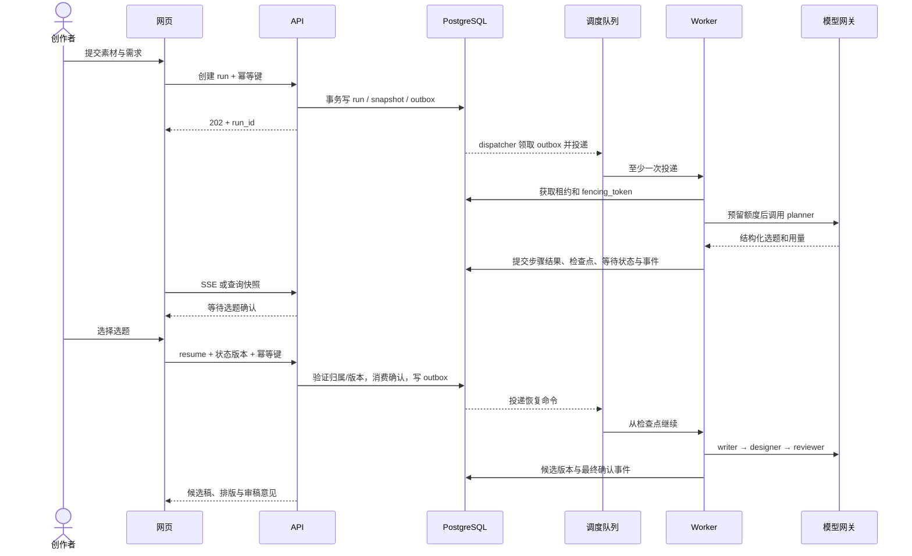

# 业务流程与任务状态设计

v0.1 · 2026-09-20 · 设计待实现。状态和参数基线：[design_contract.json](design_contract.json)。

## 1. 用户创作与 Agent 返修

主流程为：提交资料 → planner → 用户选择 → writer → designer → reviewer → 用户定稿 → 模板导出。审稿针对内容返回 writer，针对排版返回 designer；缺少资料则暂停。每次自动返修回到 reviewer，最多 2 轮后由用户决定，不自动降格为通过。

用户最终确认时可以接受、要求修改或保留草稿。要求修改进入下一段执行，run 的累计时间、用量和调用上限不重置。达到上限只能结束当前 run，并由用户明确新建；不能自动循环创建 run 绕过日额度。

## 2. 任务生命周期

| 状态 | 意义 | 可到达状态 |
| --- | --- | --- |
| QUEUED | 已持久化，待领取 | RUNNING、CANCELLED |
| RUNNING | 持有租约执行 | WAITING_USER、RETRY_WAIT、SUCCEEDED、FAILED、CANCELLED |
| WAITING_USER | 已保存检查点，不占 Worker | QUEUED、CANCELLED、EXPIRED |
| RETRY_WAIT | 等待可恢复重试 | QUEUED、FAILED、CANCELLED |
| SUCCEEDED | 本次请求的工作流目标完成 | 无 |
| FAILED | 不可自动恢复或预算用尽 | 无 |
| CANCELLED | 用户取消，后续结果不再接纳 | 无 |
| EXPIRED | 人工等待超过保留期 | 无 |

终态不可回退。FAILED 若希望再尝试，创建带 parent_run_id 的新 run，并继续受用户日额度约束。/retry 仅用于 RETRY_WAIT，不能重置失败终态。

wait_reason：topic_selection、missing_material、final_confirmation、revision_limit、version_conflict。resume_node 从服务端已记录检查点读取，不由客户端任意设置。

SUCCEEDED 对 full 请求表示成果被用户接受；导出是独立 export job，失败不会要求重复生成文案。对 rewrite/layout/review 请求，表示对应候选成果已生成并交付，是否接受由项目版本管理；界面必须区分“建议已生成”和“最终稿已确认”。

## 3. 请求、执行、事件时序

时序图的 D→Q 为 outbox dispatcher 读取数据库后投递，不是数据库直接访问消息队列。SSE 仅用于通知；断线后 GET 快照与事件游标恢复，浏览器不驱动后台持续执行。

## 4. 人工暂停与恢复

1. 节点产出资料缺口或需要确认时，把 wait_reason、resume_node、候选版本和检查点持久化，释放 Worker。
2. 用户恢复请求校验 owner、status_version、当前 WAITING_USER 状态及选题/版本归属。
3. 同事务将状态更新为 QUEUED 并写恢复命令；重复点击返回原结果，旧版本 409。
4. Worker 重新领取后恢复。暂停前的操作可能重放，因此成果保存与外部操作均要有幂等标识；不能把“恢复”理解成任意副作用只执行一次。
5. missing_material 生成新快照并使下游成果失效；若资料改变选题依据则回 planner，否则从请求补料的节点继续，路由记录在审计中。

LangGraph 的动态中断和恢复参考：[官方 interrupts 文档](https://docs.langchain.com/oss/python/langgraph/interrupts)。

## 5. 模型错误与返修不是同一回事

| 触发 | 决策 | 计数及结果 |
| --- | --- | --- |
| 429 / 临时 5xx / 网络失败 | 有限退避；Retry-After 若超过剩余时间则停止 | 同时计 attempt 与累计时限 |
| 90s 超时 | 标记调用结果不确定，核对用量后有限重试 | 可能重复费用，预留额度未核对前不释放 |
| 401 / 无效模型配置 | FAILED | 不自动重试 |
| Schema 无效 | 最多一次格式修复调用 | 消耗总调用和 Token 预算，仍无效则 FAILED |
| 审稿发现问题 | writer/designer 返修 | revision_round 加 1，最多 2 轮 |
| 资料不足 | WAITING_USER | 不自动编造；不占用 Worker |
| 用户版本已变化 | WAITING_USER(version_conflict) | 留存候选稿，禁止覆盖 |
| 总预算/时限用尽 | FAILED | 保存已有成果，明确原因 |

网络重试仅由 M06 调度；Celery 不对整个工作流开启无限 autoretry。Worker 丢失后的恢复从已提交节点开始，保留 run 的所有计数。Celery late ack 与 worker-lost 配置需要故障测试后启用，不能假设仅设置 late ack 即覆盖全部崩溃场景。

## 6. 取消、并发与导出

取消接口先持久化标记和状态；Worker 每次工具调用前后检查，供应商已经发出的请求可能无法中止，仍记录用量但不把迟到结果改成成功。租约过期后旧 Worker 不能写任何业务结果。

保存稿件使用 base_version_id 乐观锁；接受候选稿使用事务比较当前版本。review/layout/export 均关联精确版本 ID。render job 使用版本+配置哈希去重，输出 object_key、sha256、图片数量和尺寸到 manifest，缺页或文字溢出时不出“完整包”。

## 7. 流程验收场景

- 正常创作、用户放弃选题、缺少资料、审稿文案返修、仅排版返修、达到返修上限。
- 双击创建/恢复、断网重连、用户关闭页面、Worker 崩溃、Redis 重启、租约过期迟到写。
- 生成期间用户手工修改、旧审核复用、新旧导出混淆、渲染溢出、项目删除期间模型返回。
- 配额不足、总尝试上限、格式修复用量归集、未知费用处理、取消后不启动下一次模型调用。

以上是测试计划，执行结果应在实际实现后关联 commit 和原始日志记录。
