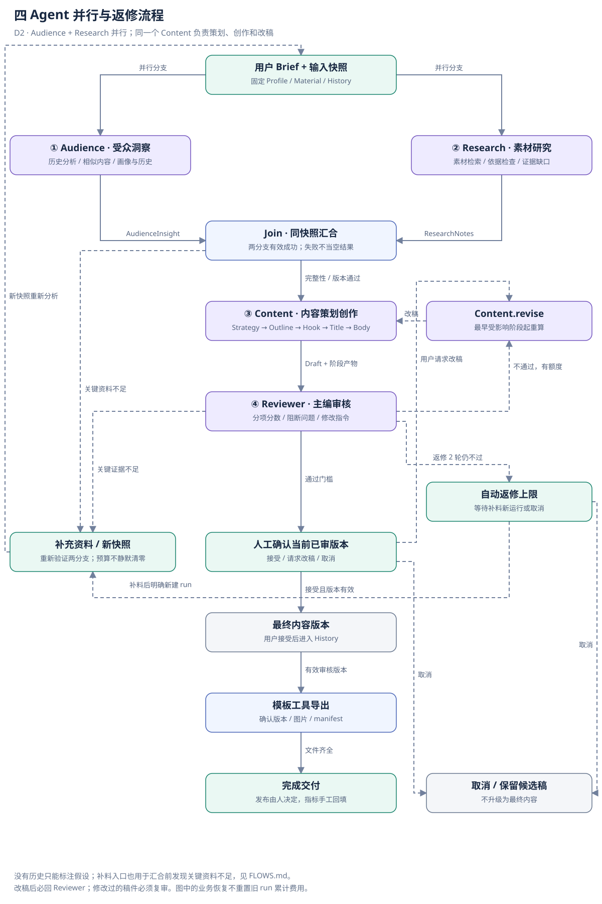
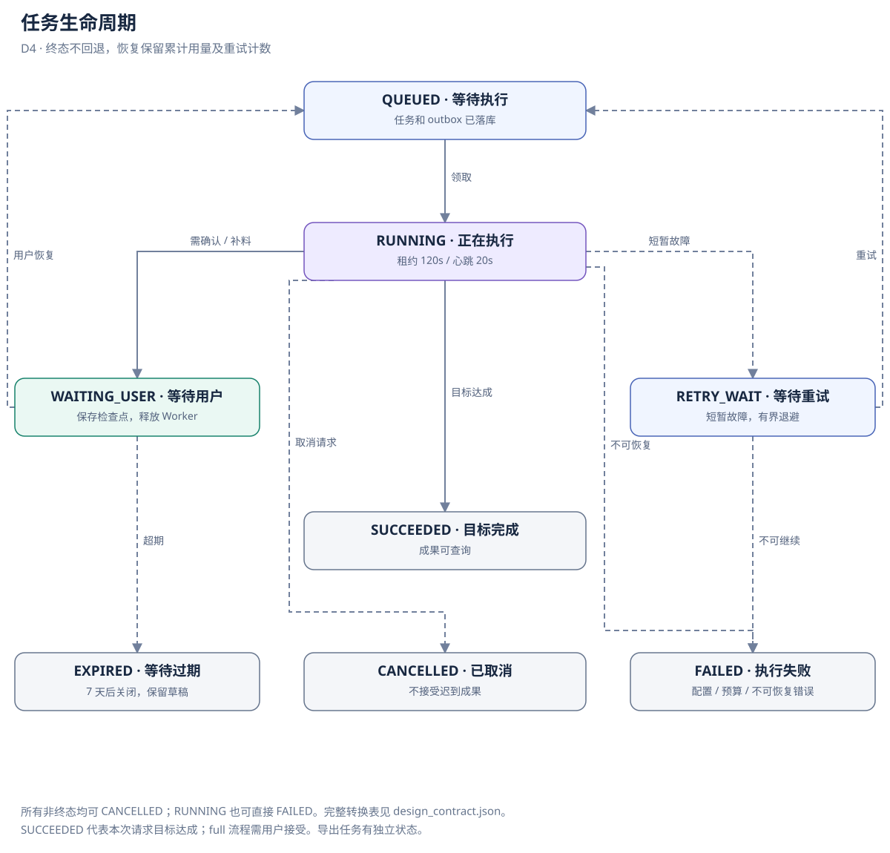
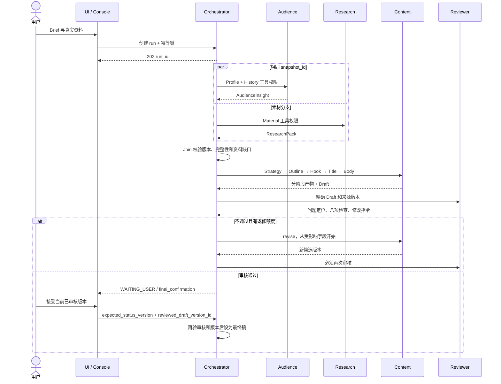

# 四 Agent 业务流程与任务状态

v0.3 · 目标设计，待实施。机器可读路由：[design_contract.json](design_contract.json)。

## 1. 主流程与返修

Brief → 同一快照分发 → audience / research 并行 → Join 校验 → content 五阶段 → reviewer → 人工确认 → 最终版本 → 模板导出。

reviewer 不通过 → content.revise → reviewer 再审；改稿不能直接成为最终内容。关键资料不足 → 用户补料 → 新快照 → 重新并行分析；返修次数耗尽 → 等待补料或取消，不能“绕过检查后通过”。

默认不再在生成前强制选题确认；用户仍可在 Brief 指定主题，在 Console 查看 Strategy，或取消后调整需求。未来若添加策略确认，必须作为显式 WAITING_USER 节点，不增加第五个 Agent。

## 2. 任务生命周期

| 状态 | 意义 | 可到达状态 |
| --- | --- | --- |
| QUEUED | 已持久化，待领取 | RUNNING、CANCELLED |
| RUNNING | 持有租约执行 | WAITING_USER、RETRY_WAIT、SUCCEEDED、FAILED、CANCELLED |
| WAITING_USER | 已保存检查点，不占 Worker | QUEUED、CANCELLED、EXPIRED |
| RETRY_WAIT | 等待可恢复重试 | QUEUED、FAILED、CANCELLED |
| SUCCEEDED | 本次请求的工作流目标完成 | 无 |
| FAILED | 不可自动恢复或硬执行时限用尽 | 无 |
| CANCELLED | 用户取消，后续结果不再接纳 | 无 |
| EXPIRED | 人工等待超过保留期 | 无 |

终态不可回退。FAILED 若希望再尝试，创建带 parent_run_id 的新 run，并继续受用户日额度约束。/retry 仅用于 RETRY_WAIT，不能重置失败终态。

wait_reason 以 [统一执行协议](AGENT_PROTOCOL.md) 为准，包含资料、假设授权、确认、返修、冲突、预算和规则等待。resume_node 从服务端已记录检查点读取，不由客户端任意设置。

SUCCEEDED 对 full/rewrite 请求均要求当前稿审核有效且用户接受；layout/review 辅助请求仅表示该项产物已生成，不能自动将项目稿件标为最终稿。导出是独立 export job，失败不需要重生成文案。

## 3. 并行分支与汇合屏障

1. Orchestrator 冻结 Profile、Material、History 和 Brief 的 snapshot_id，预留两个分支的预算。
2. audience、research 并行运行，各自记录输入/输出、Tool 调用和 Memory 读取；分别保存 branch_results，不能覆盖整个共享状态。
3. Join 仅在两个结果都通过 Schema、权限、来源和快照版本校验后放行。历史样本为 0 可以是成功结果；核心资料不足触发人工补料；非核心缺口限制主张后可继续，不是忽略 research。Join 还须检查受众与素材能共同兑现 Brief。
4. 单分支失败：只重试失败分支，保留同快照成功结果。不可恢复时取消另一分支后续操作并终止本 run；已发生的费用仍计入。
5. 用户补料或改 Brief 导致快照变化，旧分支结果失效，两者重算；输入完全不变的传输重试才复用成功分支。

时序图展示一次返修；循环条件和额度由状态机执行。所有阶段均发送 Console 事件，图中为清晰起见未重复画出。

## 4. Content 阶段、返修与审核门槛

Strategy 保存受众、角度、承诺、证据计划；Outline 保存段落结构；Hook 保存开头；Title 默认保存 5 个候选（最少 2 个）和选定标题；Body 保存段落、素材引用、标签与封面建议。每阶段只写自己的产物，下游引用上游版本。

若所有阶段分别调用，基础流程为八次模型调用；策略之后可合并生成，按实际调用计数。最多两轮返修，16 次模型尝试或 80000 Token 可能先耗尽；不能保证一定返修满两轮。预算耗尽保存产物进入 WAITING_USER/budget_exhausted，禁止在原 run 加预算重启；硬执行时限到达 FAILED。

Reviewer 使用八项检查及问题严重度，不再以综合分数放行。程序验证检查齐全、重要问题均解决、引用/版本/规则有效和决定一致；完整守卫及补研究上限见 [统一执行协议](AGENT_PROTOCOL.md)。

## 5. 人工确认、补料和版本冲突

WAITING_USER 不占 Worker。恢复必须校验身份、wait_reason、status_version、snapshot_id 和 draft_version_id。accept 仅在 final_confirmation 且审核有效时允许；重复点击按幂等键返回原结果。

用户手工编辑任何已审核稿都会产生新 candidate，旧审核失效；重新经过 reviewer 后才可接受。请求改稿进入同一个 content.revise，累计预算不重置。达到自动返修上限后只有补料并重新开明确的新运行或取消；不能通过无限 resume 绕过上限。

missing_material 补料产生新快照，一个 run 最多一次补研究，当前 run 预算及次数足够时从 Brief 分支重新执行；不足则结束并由用户明确新建 run。revision_limit 的补料结束旧 run，创建 parent_run_id 关联的新 run，继续受日额度约束。图中 supply → brief 是业务恢复路径，不表示重置旧 run 的计数。

旧任务基于 v3 返回，但用户已保存 v4：保留为旧版本建议并进入 version_conflict，用户选择以当前稿新建运行或取消；不得自动覆盖。任何恢复动作来自服务端白名单，不接受模型输出任意节点名。

## 6. 错误、取消与资源约束

| 情况 | 处理 | 不允许 |
| --- | --- | --- |
| Tool 无结果 | 返回空及缺口，按业务判断继续/补料 | 冒充成功搜索或历史结论 |
| Tool 超时 | 有限只读重试，记录错误事件 | 用空结果掩盖失败 |
| 模型 429/临时 5xx | 2 次额外退避重试，受总预算和时限约束 | SDK 与 Worker 叠加无限重试 |
| 模型认证/配置错误 | FAILED | 自动重复请求 |
| JSON 不合格 | 最多 1 次修复调用，再错 FAILED | 忽略结构校验 |
| 并行一支失败 | 保留同快照成功分支，只恢复失败支 | 整段从头付费重跑 |
| 用户取消 | 标记取消，阻止新 Tool/模型调用 | 迟到结果把 CANCELLED 改成功 |
| Worker 崩溃 | 租约回收、检查点恢复、fencing 拒绝旧写入 | 假设队列天然恰好一次 |
| 审稿不过/上限 | revise / WAITING_USER | 直接输出最终稿 |

供应商调用已经发出时取消不一定能撤销费用；记录 unknown 用量并保守保留额度。持久化节点输出和检查点不一致时，用唯一 step_key 对账重放，不能重复提交候选稿。

## 7. 导出、历史与反馈

正式 export_bundle 只允许 Orchestrator 在用户接受且审核版本有效时调用。模板溢出/缺图时返回错误或预览，不能标完整导出；修改稿件需复审。渲染失败只重试渲染。

最终稿进入 History 的 accepted 状态，并不代表已经发布。用户手工标记 published_at 并回填 observed_at 和指标后，才进入后续 audience 的历史分析视图；不把模型评分写成发布效果。

## 8. 验收重点

并行乱序完成、单支超时、快照不一致、无历史冷启动、无素材、工具越权、注入内容、不同观察窗口不可比、五阶段局部失效、改稿复审、审核决定与问题清单冲突、过期确认、人工编辑、预算提前耗尽、取消后迟到结果、Console 断线与事件重放。测试结果在真实实现后记录。

## v0.4 运营扩展边界

本文件保留 v0.3 创作子流程契约；热点、国内平台发布、指标回流与学习为 [v0.4 技术提案](ARCHITECTURE.md#运营闭环-v04-技术提案)，尚未实现。运营对象采用独立状态，创作 SUCCEEDED 不代表发布成功。当前代码进度见 [开发记录](../IMPLEMENTATION_STATUS.md)，不要将历史设计中的“待实现”覆盖已验证能力，也不要把提案字段直接当成现有 API。
