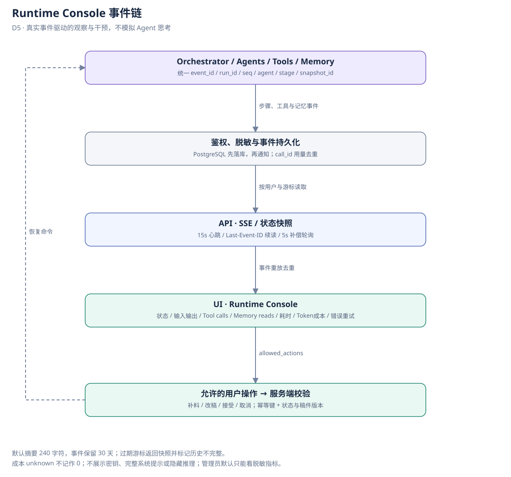

# Runtime Console 设计

v0.3 · L1 UI 中的运行观察与干预界面，不是 Agent 的聊天群，也不显示隐藏推理过程。

## 1. 用户视图

顶部显示 run 状态、当前阶段、并行分支、累计用量和等待用户原因。中部时间线可展开 Agent/阶段，下部展示候选稿、Strategy、证据缺口及可用操作。两条研究分支并排展示，只有均成功且快照一致才显示 Join 完成。

| 标签 | 显示字段 | 展示约束 |
| --- | --- | --- |
| 状态 | run_id、agent、current_stage、run_status、wait_reason | 区分执行完成、审核通过、用户确认、已发布 |
| 输入 / 输出 | input_summary、artifact_ref、schema_version、snapshot_id | 摘要默认最多 240 字符；原文仅本人按需查看 |
| Tool calls | tool、参数摘要、结果摘要、耗时、error_code | 工具调用真实产生事件，不能用动画伪造 |
| Memory reads | store、record_ids、version、query_summary、命中数 | 区分“无数据”和“读取失败”；来源可追踪 |
| 耗时 | started_at、duration_ms、queue_ms、wait_user_ms | 模型执行与人工等待分开，不能合算生成速度 |
| Token / 成本 | input/output tokens、价格版本、currency、cost_status | pending/estimated/confirmed/unknown；unknown 不等于 0 |
| 错误 / 重试 | attempt、error_code、retryable、retry_at | 展示下一步操作，不暴露密钥或供应商敏感响应 |

操作按钮由后端 allowed_actions 驱动：取消、补料、改稿、接受、恢复可重试失败。暂停点没有许可的操作不显示且后端拒绝。accepted 之后的修改创建新候选，不回写已经接受的版本。

## 2. 事件契约

RuntimeEvent：schema_version=2、event_id、run_id、seq、occurred_at、type、agent（可空）、stage（可空）、attempt、snapshot_id、draft_version_id、payload、visibility。

事件类型以 [机器契约](design_contract.json) 的 events 列表为唯一来源，覆盖 agent/tool/branch 的执行、memory 读取/候选、artifact.created、validation.failed、workflow.transition、人工确认、重试和费用变化；禁止使用 artifact.saved 等另一套别名。

后端分配单 run 单调递增 seq 并先落库，再通知 SSE；客户端按 (run_id,seq) 去重。并行阶段的实际先后看 occurred_at，不用数组位置虚构依赖。每次开始事件应有完成或失败事件；崩溃时经租约回收补事件并标 recovered。

## 3. 持久化、断线与隔离

GET /runs/{id}/events 需用户归属校验，Last-Event-ID 续读；客户端也可使用 after=seq，冲突时拒绝不一致游标。客户端 15s 心跳，断线用 5s 补偿轮询；断线不停止 Worker。事件默认保留 30 天，游标过旧返回 reset_required 和当前状态快照，界面注明历史事件不完整。

事件日志默认只存摘要和产物引用；用户原文按项目权限读取，管理员默认只有脱敏指标。密钥、Cookie、Authorization 头、系统完整提示及隐藏推理不写日志。取消/删除项目后按保留策略清理产物与事件，下载链接撤销。

价格从服务端版本化配置读取，未知价格只展示 Token；调用前预留最坏输出额度，调用后结算。不能将每个 usage.updated 的累计值再次求和；账本以 call_id 唯一，Console 显示账本聚合结果。

## 4. 验收

同时启动的两分支可见；工具/记忆失败不显示成功；断线后事件不重复；过期游标恢复快照；用户 A 无法看 B 的事件或产物；人工等待不计执行时长；usage 重放不重复计费；未审核稿没有 accept 操作；所有按钮有后端幂等和版本校验。当前 starter 的 traces 展开列表不能视为已实现此 Console。
